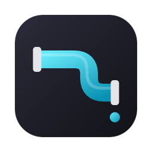
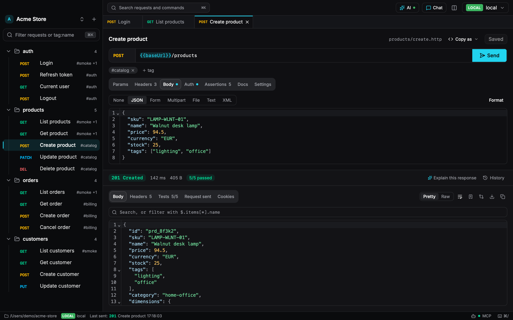
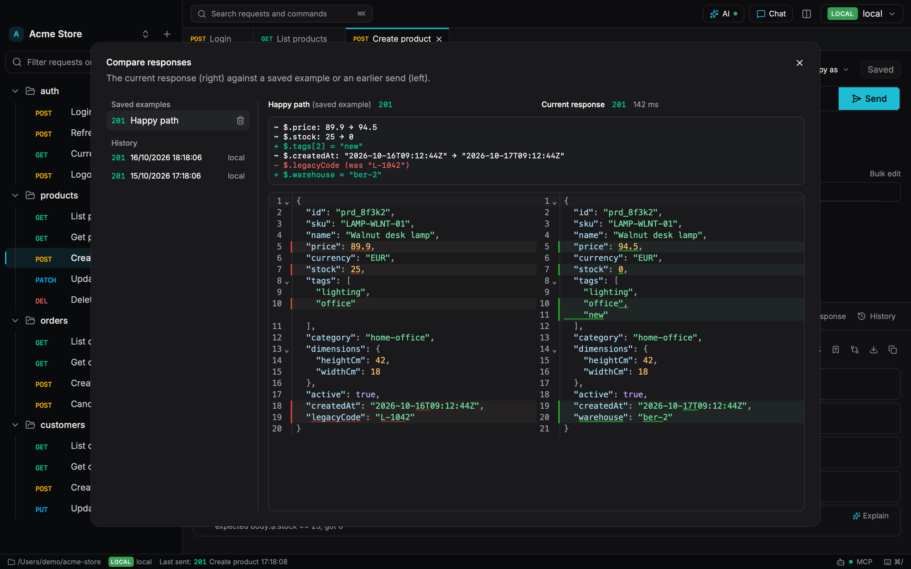
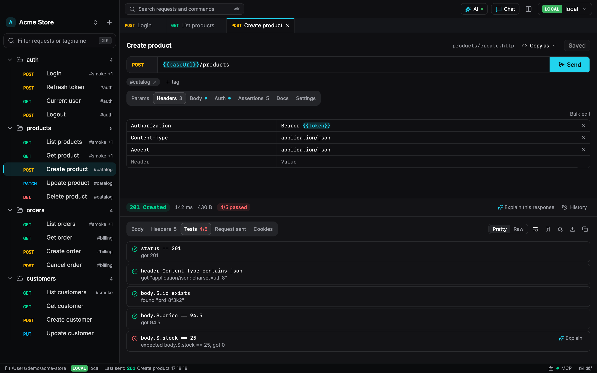
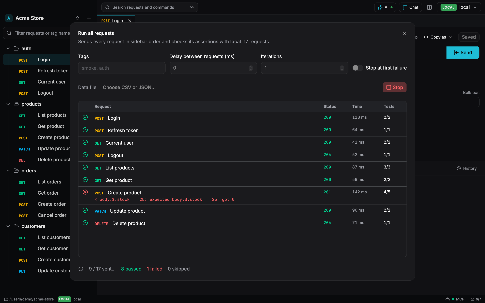
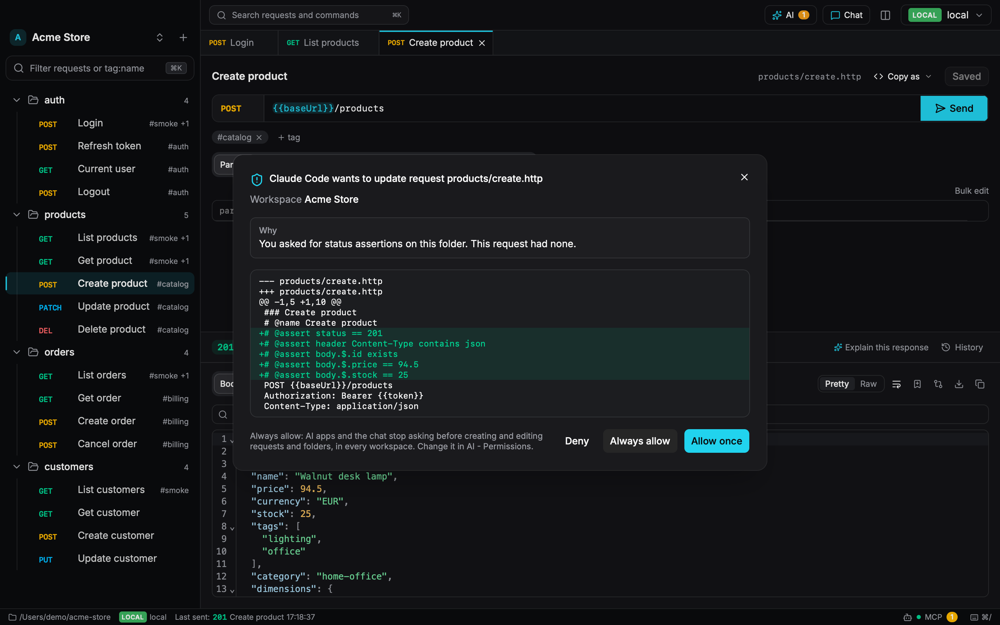

<p align="center">
  
</p>

<h1 align="center">Plumbq</h1>

<p align="center">
  <b>The open-source, local-first API client your AI assistant can work in.</b><br />
  A Postman, Insomnia and Bruno alternative where requests are plain <code>.http</code> files in your repo.<br />
  No account, no cloud, no lock-in.
</p>

<p align="center">
  <a href="#features">Features</a> ·
  <a href="#plumbq-vs-postman-insomnia-bruno-and-yaak">Comparison</a> ·
  <a href="#ai-assistant-and-mcp-server">AI and MCP</a> ·
  <a href="#install">Install</a> ·
  <a href="#faq">FAQ</a> ·
  <a href="docs/spec.md">Roadmap</a>
</p>

<p align="center">
  <a href="LICENSE"></a>
  <a href="https://github.com/talovicnedim/plumbq/actions/workflows/ci.yml"></a>
  
  
</p>

<!-- Screenshots and clips: see docs/screenshots/README.md for the shot list -->
<p align="center">
  
</p>

**Plumbq** is a free, open-source (MIT) desktop **REST API client** for macOS, Windows and
Linux. It keeps every request as a plain `.http` file, the format the **JetBrains HTTP Client**
and the **VS Code REST Client** already understand, so your API collection lives in git next to
your code. Send requests, check responses with assertions, chain requests, run them in CI, and
let Claude, ChatGPT, Cursor or any MCP client organize, run and debug them with you, with your
approval for every change. Built with Rust, Tauri and Svelte.

## Why Plumbq

Postman and Insomnia push you into accounts and cloud sync, and their AI features only work in
their cloud with their model. Your API collection ends up in a format only their app can read.

Plumbq keeps your requests as plain `.http` files. Commit them next to your code, review them in
pull requests, edit them in your editor, and bring your own AI.

- **Your files, your format.** A workspace is any folder. No export step, no proprietary format.
- **Bring your own AI.** Built-in chat with your own key or a local model, plus an MCP server for
  the AI apps you already use.
- **Safe around production.** Secrets live in the OS keychain, and writes to production need you
  to type the environment's name, enforced in the core.
- **Works in CI.** The `plumbq` CLI runs the same requests and assertions in GitHub Actions,
  GitLab or Jenkins.

## A workspace on disk

```
my-api/
  folder.toml               order = ["auth", "users"], shared headers
  environments/
    local.toml              tag = "local", baseUrl = "http://localhost:8000"
    production.toml         tag = "production", secrets = ["token"]
  auth/
    login.http
  users/
    list-users.http
    create-user.http
```

```http
### Create user
# @assert status == 201
POST {{baseUrl}}/users
Authorization: Bearer {{token}}
Content-Type: application/json

{"name": "Ada"}
```

The full format, with assertions, chaining, variables and settings, is in
[docs/formats.md](docs/formats.md).

## Features

### `.http` files you own

- A workspace is any folder. Create a new one from the app or open an existing repo
- One request per `.http` file, compatible with the JetBrains HTTP Client and VS Code REST
  Client; multi-request files work too
- Saving is lossless: comments, directives, file variables and line endings survive every save
- Folders are directories; `folder.toml` stores their order and headers shared by every request
  below them, and the root one holds workspace-wide variable defaults that environments override
- Request docs in markdown (plain `#` comments above the request) and `# @tag smoke` tags, with
  `tag:smoke` filtering in the sidebar and ⌘K
- Duplicate folders, bulk-edit headers and params as text, and manage tabs from a right-click
  menu (close others, to the right, all) or by dragging them
- Edits from git, your editor or an AI agent show up live in the app
- Switch between workspaces with ⌘P

### Send requests and inspect responses

<p align="center">
  
</p>

- Request editor with params, headers, body (JSON, form, text, XML, file, multipart) and auth
  (Bearer, Basic, API key, OAuth 2.0 with PKCE or client credentials)
- Response viewer with status, timing, size, pretty JSON, headers and exactly what was sent
- Response previews (images, PDF, sandboxed HTML, audio, video), a JSON path filter
  (`$.items[*].name`), save body to a file, and cancel a running request (Esc)
- Per-request history, kept on your machine and out of your repo; it follows requests you move
  or rename
- Saved response examples, committed next to the request (`<name>.examples.json`) as living
  documentation that AI agents can read too
- Compare a response with an example or an earlier send: a side-by-side diff plus a list of the
  JSON fields that changed
- A cookie jar per environment: cookies set by responses are sent back like a browser would,
  and staging cookies never reach production
- Saving never overwrites changes made elsewhere: if an editor, git or an AI agent changed the
  file since you opened the request, you choose to reload it or keep yours as a new request

### API testing with assertions

<p align="center">
  
</p>

- Assertions run on every send and show as a Tests tab: `# @assert status == 201`,
  `# @assert body.$.items.length > 0`, `# @assert header Content-Type contains json`, and with
  variables: `# @assert body.$.id == {{userId}}` (secrets compare as `{{name}}`, never shown)
- Runner: run a folder or everything with live results, tags, delays, iterations and data-driven
  runs from a CSV or JSON file; save results as JUnit or JSON

### Variables and request chaining

- Variables like `{{baseUrl}}`, plus `{{$uuid}}`, `{{$timestamp}}`, `{{$isoTimestamp}}` and
  `{{$randomInt}}`
- `{{$prompt otp}}` asks for a value when you send (masked in history), `{{$processEnv NAME}}` /
  `{{$env.NAME}}` read OS environment variables, and `{{$dotenv NAME}}` reads a local `.env`
- Request chaining: `{{login.response.body.$.token}}` or `{{login.response.headers.Location}}`
  uses the latest response of another request (by `# @name login`, name or file name)
- REST Client file variables (`@host = api.test`), any HTTP method (`PURGE`, `PROPFIND`, …),
  file bodies (`< ./data.json`, or `<@ ./data.json` to resolve `{{variables}}` inside the file)
  and multipart uploads with files
- Per-request settings as JetBrains directives (`# @no-redirect`, `# @timeout 60`,
  `# @no-cookie-jar`, `# @insecure`) and workspace defaults for timeouts, redirects, TLS
  verification, proxies (HTTP, SOCKS5, system), CA certificates and client certificates (PEM or
  PKCS#12 `.pfx`, with the password in the OS keychain)

### Environments and secrets

- Environments in `environments/*.toml`, tagged local, development, staging or production.
  Saving keeps your comments and any keys the app doesn't know; a secret is only ever removed
  when you remove it
- Secret values live in the OS keychain; files only hold their names, and responses, history and
  "copy as cURL" show them as `{{name}}`
- A red banner while a production environment is selected; anything other than GET, HEAD and
  OPTIONS on a production environment asks you to type the environment name first, enforced in
  the core, not just the UI

### Import from Postman, OpenAPI, Insomnia, Bruno and cURL

- Paste a cURL command to create a request (including `-F` file uploads and `--data-urlencode`)
- Import from Postman, OpenAPI 3 / Swagger 2 (file or URL), Insomnia, HAR recordings and Bruno
  collections. Importing the same collection again updates it instead of duplicating it, and
  never overwrites your edits or your renames
- Credentials found in imports become `{{secret}}` placeholders instead of being written to files

### Export and code generation

- Copy any request as cURL, JavaScript `fetch`, Python `requests`, PHP (Laravel `Http`), Go or
  HTTPie
- Export a folder to a Postman v2.1 collection (plus environments), or the whole workspace to a
  single-page HTML API documentation

<p align="center">
  
</p>

### Run API tests in CI

```bash
plumbq run api/ --env staging --reporter junit --output results.xml
```

Sends every request in order and fails the build when an assertion fails. Production writes are
skipped unless you pass `--allow-production-writes`. See [crates/cli](crates/cli/README.md).

## AI assistant and MCP server

<p align="center">
  
</p>

- One AI dialog (the AI button, ⌘⇧I) with four tabs: Chat, AI apps, Permissions, Activity
- A built-in **MCP server for API testing**: connect Claude Code, Claude Desktop, Cursor,
  VS Code or Codex with one click (or copy the setup), or ChatGPT through a tunnel, and ask it to
  organize the workspace, write requests and assertions, document the API or debug a failing call
- Every change an agent wants pops up in the app with exactly what would happen (the request as
  it would be sent, or a diff of the file) and its reason: Allow once, Always allow (that kind of
  change from now on) or Deny. Production writes and deletes need you to type the environment's
  name and can't be allowed for good
- A Read-only switch, environments you can hide from the AI, and permissions per kind of action
  (send, change data, edit files, environments, delete): Allow, Ask or Deny. Secrets never reach
  the agent, and can't be sent to hosts outside the environment without you
- An activity log of everything the chat and AI apps read, changed and sent, with the source of
  each
- Claude Desktop and Codex connect through the bundled `plumbq-mcp --url …` bridge (no
  Node.js); for headless use, `plumbq-mcp --workspace …` serves one folder and asks the
  running app for approval
- A built-in chat (⌘J): Anthropic Claude, OpenAI, Gemini, any OpenAI-compatible URL (OpenRouter,
  Groq, …), or a local model in Ollama or LM Studio, using your own key (kept in the OS
  keychain). It works only through the same MCP tools, permissions and approval dialogs as
  connected agents
- "Explain this" buttons (a failed send or response, a failing assertion, "Write tests for
  this", "Document this") open the chat with the question. "Turn AI off" hides all of it

Example asks: "group these by resource and sort CRUD-style", "move hardcoded tokens into
environment variables", "add status assertions to every request", "run login then /orders on
staging and explain the 403". See [docs/ai.md](docs/ai.md) for the full design and
[crates/mcp](crates/mcp/README.md) for the tool list.

### Connect Claude Code, Cursor or another AI app

In Plumbq, open **AI → AI apps**, pick your app and click **Connect**. Or copy the address
the app shows and add it yourself:

```bash
claude mcp add --scope user --transport http plumbq http://127.0.0.1:7459/mcp/<token>
```

The token in the address is the only credential, so keep it private. Claude Desktop and Codex
start the bundled `plumbq-mcp --url <address>` bridge, which **Connect** sets up for you.

<details>
<summary><b>Keyboard shortcuts</b></summary>

| Keys     | What it does             |
| -------- | ------------------------ |
| ⌘↵       | Send the request         |
| ⌘.       | Cancel a running request |
| ⌘S       | Save                     |
| ⌘N       | New request              |
| ⌘K       | Command palette          |
| ⌘E       | Recent requests          |
| ⌘P       | Switch workspace         |
| ⌘O       | Open workspace           |
| ⌘1-9     | Go to tab 1-9            |
| ⌘W / ⇧⌘W | Close tab / close all    |
| ⇧⌘I      | AI dialog                |
| ⌘J       | AI chat                  |
| ⌘,       | Settings                 |

On Windows and Linux, use Ctrl instead of ⌘. ⌘/ shows every shortcut in the app.

</details>

## Plumbq vs Postman, Insomnia, Bruno and Yaak

|                                   | Plumbq                                   | Postman / Insomnia       | Bruno / Yaak                  |
| --------------------------------- | ---------------------------------------- | ------------------------ | ----------------------------- |
| Where requests live               | `.http` files in your repo               | The app and its cloud    | Files in the app's own format |
| Readable by JetBrains and VS Code | Yes                                      | No                       | No                            |
| Account needed                    | No                                       | Pushed toward one        | No                            |
| AI                                | Your own key, local model or any MCP app | Their cloud, their model | Not the focus                 |

If you want a **Postman alternative without an account**, a **Bruno alternative** that uses the
standard `.http` format, or a desktop app for your existing **REST Client** files, Plumbq is
built for that.

## Install

Download the installer for macOS (`.dmg`), Windows (`.msi` or `-setup.exe`) or Linux
(`.AppImage`, `.deb` or `.rpm`) from [Releases](https://github.com/talovicnedim/plumbq/releases/latest).

Or build from source:

```bash
pnpm install
pnpm build   # installers end up in target/release/bundle
```

The builds aren't signed yet. On macOS the first launch is blocked: open System Settings >
Privacy & Security and click **Open Anyway**, or run
`xattr -dr com.apple.quarantine "/Applications/Plumbq.app"`. On Windows, if SmartScreen says
"Windows protected your PC", click **More info**, then **Run anyway**. Maintainers: see
[docs/RELEASING.md](docs/RELEASING.md) for signed releases and auto-updates.

The app runs its MCP server itself (AI → AI apps) and bundles two companion binaries next
to its executable: `plumbq-mcp` (the stdio bridge Claude Desktop and Codex start, or the same
MCP server standalone for one workspace) and `plumbq-cli` (runs requests and assertions, e.g.
in CI). `pnpm build` compiles them first with `scripts/build-sidecars.mjs`.

Open `examples/jsonplaceholder` for a workspace that works against a public test API.

## Quick start

1. Open Plumbq and press ⌘O to open `examples/jsonplaceholder` from this repo, or create a new
   workspace.
2. Pick an environment, open a request and press ⌘↵ to send it.
3. Look at the response and the **Tests** tab, then add your own `# @assert` lines.

Already have requests? Paste a cURL command into the URL bar, or import a Postman collection or
an OpenAPI spec.

## Security

- Secret values are stored only in the OS keychain (macOS Keychain, Windows Credential Manager,
  Secret Service on Linux) and masked everywhere they could be shown or stored
- Production environments require confirmation for anything that can change data
- History and cookies stay on your machine, outside the workspace, so they never end up in git
- Request and response contents are never logged
- No accounts, no telemetry, no cloud

Found a vulnerability? Please follow [SECURITY.md](SECURITY.md).

## FAQ

### What is an `.http` file?

A plain text file with an HTTP request in it: method, URL, headers and body. The JetBrains HTTP
Client (IntelliJ, PhpStorm, WebStorm) and the VS Code REST Client extension run these files, and
Plumbq reads and writes the same format, so your requests work in all three.

### Can I use Plumbq without an account?

Yes. There is no account, no login and no cloud sync. Your workspace is a folder on your disk,
and you share it with git like any other code.

### Can I import my Postman collections?

Yes. Plumbq imports Postman collections, OpenAPI 3 and Swagger 2 specs, Insomnia exports, HAR
files, Bruno collections and cURL commands. It can also export back to Postman v2.1.

### Can I run my API tests in CI?

Yes. `plumbq run` sends the requests of a folder, checks their `# @assert` lines and writes a
JUnit or JSON report for GitHub Actions, GitLab, Jenkins and others.

### Can Claude or ChatGPT use Plumbq?

Yes. Plumbq has a built-in MCP server and a built-in chat. AI can read, write, organize and send
requests, but every change and risky send needs your approval, and secret values never reach
the AI.

### Is Plumbq free?

Yes. Plumbq is open source under the MIT license, with no account and no telemetry.

## Development

Requirements: [Rust](https://rustup.rs), Node 22+ and [pnpm](https://pnpm.io) 10. On macOS also
the Xcode Command Line Tools; on Linux the
[Tauri prerequisites](https://v2.tauri.app/start/prerequisites/).

```bash
pnpm install
pnpm dev      # run the desktop app with hot reload (Vite on port 5174)
pnpm check    # format, lint, type-check and all tests
```

In dev, the MCP server and CLI are plain workspace binaries: `cargo build -p plumbq-mcp`
puts the server next to the dev app in `target/debug/`, where **Connect AI** finds it.
`pnpm sidecars` builds the release sidecars on their own.

See [CONTRIBUTING.md](CONTRIBUTING.md) for how the code is organized.

## What's next

- Reviewing big AI edits as one diff before they're applied (changesets)
- Later: GraphQL with schema autocomplete, WebSocket and SSE, gRPC, a mock server and Laravel
  route discovery

See the [roadmap](docs/spec.md#roadmap) and the [changelog](CHANGELOG.md).

## Feedback and contributing

Found a bug or missing a feature? [Open an issue](https://github.com/talovicnedim/plumbq/issues). Pull requests are
welcome; [CONTRIBUTING.md](CONTRIBUTING.md) explains how the code is organized.

If Plumbq is useful to you, a star on GitHub helps other people find it.

## Related projects

Open-source, local-first tools built the same way:

- [Tugdeck](https://github.com/talovicnedim/tugdeck) - desktop GUI for Docker Swarm and Kubernetes
- [Rowcove](https://github.com/talovicnedim/rowcove) - database client with built-in diagnostics
- [Berthq](https://github.com/talovicnedim/berthq) - message broker in one binary
- [Steerq](https://github.com/talovicnedim/steerq) - terminal workspace for AI coding agents

## License

[MIT](LICENSE)
